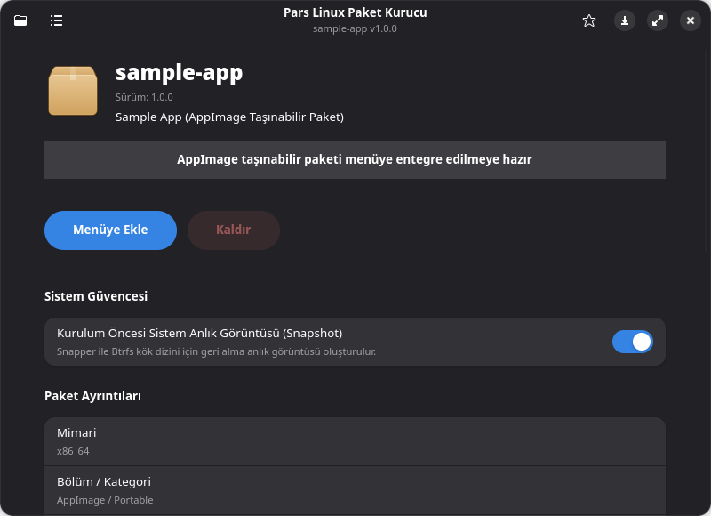
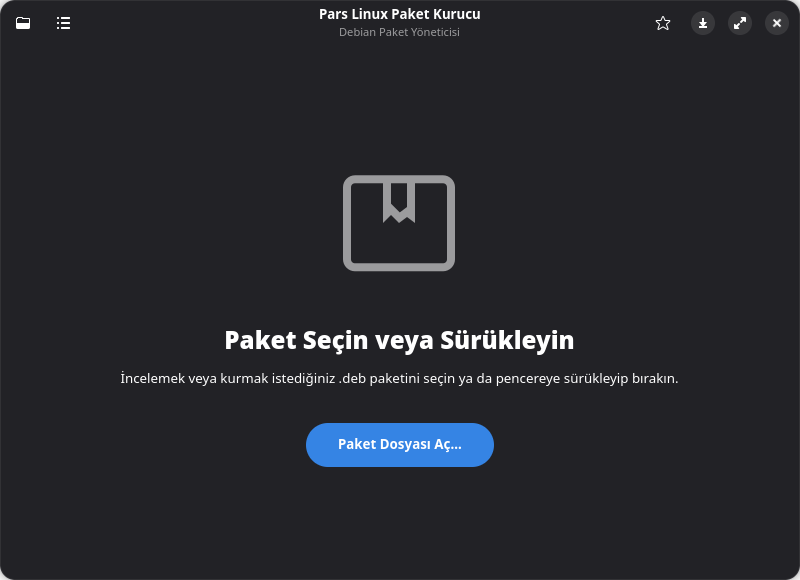

<p align="center">
  
</p>

# Pars Linux Package Installer

**Pars Linux Package Installer** (`parslinux-package-installer`), Pars Linux, Debian ve Arch Linux tabanlı dağıtımlar için tasarlanmış, saf **GTK 4 ve Libadwaita** arayüzüne sahip, evrensel ve modern bir paket kurucu ve inceleme aracıdır.

İndirilen veya yerel diskte bulunan `.deb` ve `.pkg.tar.zst` arşivlerine dosya yöneticisinden çift tıklandığında otomatik açılır, paket metaverilerini ve içerilen dosya ağacını listeler, bağımlılıkları denetler; tek tıkla kurulum, yeniden kurulum, yükseltme, sürüm düşürme veya sistemden kaldırma imkânı tanır.

---

## 🚀 Öne Çıkan Özellikler

- **💎 Saf GTK 4 & Libadwaita Deneyimi**: GNOME tasarım ilkeleriyle %100 uyumlu, pürüzsüz animasyonlar, Toast bildirimleri ve karanlık tema uyumu.
- **🌐 Evrensel Çoklu Dağıtım Desteği (Multi-Distro)**:
  - **Debian / Pars Linux**: `.deb` paketlerini saf Python ayrıştırıcı veya `python3-apt` önbelleği ile inceleme, APT motoru ile kurma.
  - **Arch Linux**: `.pkg.tar.zst`, `.pkg.tar.xz`, `.pkg.tar.gz` paketlerini `.PKGINFO` üzerinden okuma, dosya ağacını zstd ile açma, `pacman` motoru ile kurma ve yönetme.
  - **Fedora / Red Hat / openSUSE**: Bağımsız ikili başlık ayrıştırıcısıyla `.rpm` paketlerini sıfır harici C binding gereksinimiyle inceleme.
  - **Arch'ta .deb Kurulumu**: Arch Linux üzerinde `debtap` yüklüyse `.deb` dosyalarını otomatik dönüştürüp yerel paket olarak kurabilme.
- **📦 AppImage Taşınabilir Paket Entegrasyonu (.AppImage)**:
  - AppImage paketlerini ELF başlıklarından otomatik tanıma, tek tıkla yürütme izni verme (`chmod +x`), sistem uygulama menüsüne (`~/.local/share/applications/`) entegre etme veya tek tıkla doğrudan başlatma.
- **🌐 Flathub & Flatpakref Desteği (.flatpakref & .flatpakrepo)**:
  - Flathub `.flatpakref` uygulama bağlantılarını ve `.flatpakrepo` depolarını tek tıkla sisteme entegre etme.
- **🛡️ Btrfs & Timeshift Sistem Güvencesi**:
  - Kurulum öncesi otomatik sistem geri yükleme noktası (Snapshot) oluşturma ve masaüstü bildirimleri (`Notify`).
- **📦 Toplu Kurulum Kuyruğu (Batch Queue)**:
  - Birden çok paketi aynı anda seçip veya sürükleyip bırakarak toplu kuyruğa ekleme.
  - Tek bir PolicyKit yetkilendirme oturumu ile tüm kuyruğu sıralı ve bağımlılık uyumlu kurma.
- **🔍 İçerilen Dosyalar Canlı Arama (Included Files)**:
  - Paket içerisindeki tüm dosya ve dizinleri dosya türü ikonları, izin modları ve boyutlarıyla listeleme.
  - Anlık arama çubuğu ile sıfır gecikmeli dosya süzme.
- **⚡ Headless CLI Teftiş Modu**:
  - `parslinux-package-installer -i paket.deb / paket.pkg.tar.zst / app.AppImage`: Arayüz açmadan terminalde ayrıntılı metaveri dökümü.
  - `parslinux-package-installer -c paket.deb / paket.pkg.tar.zst`: Bağımlılıkları kontrol edip eksik paketleri raporlama (otomasyonlar için exit code 0 veya 1).
- **🌐 Uzak URL'den Doğrudan Açma**:
  - `parslinux-package-installer https://example.com/yazilim.deb` şeklinde verilen uzak paketleri geçici dizine indirip anında inceleme.
- **🛡️ Güvenli Yetkilendirme & Onay Pencereleri**:
  - Yetki gerektiren tüm işlemler PolicyKit (`pkexec`) ile yönetilir.
  - Kazara paket silinmesini önleyen onay pencereleri (`MessageDialog`).

## 📸 Ekran Görüntüleri

<p align="center">
  
  
</p>
<p align="center">
  
  
</p>
<p align="center">
  
  
</p>

---

## 📦 Sistem Gereksinimleri

### Debian / Ubuntu / Pars Linux
```bash
sudo apt install python3 python3-gi gir1.2-gtk-4.0 gir1.2-adw-1 gir1.2-notify-0.7 zstd policykit-1
# İsteğe bağlı
sudo apt install python3-apt
```

### Arch Linux / Manjaro / EndeavourOS
```bash
sudo pacman -S python python-gobject gtk4 libadwaita libnotify zstd polkit
# İsteğe bağlı (Arch'ta .deb dönüştürmek için)
yay -S debtap
```

---

## 🛠️ Hızlı Otomasyon Betikleri

Depo kök dizininde geliştirme, test, çalıştırma ve paketlemeyi kolaylaştıran taşınabilir betikler yer alır:

```bash
# Uygulamayı yerel kaynak koddan başlatma:
./run.sh
./run.sh paket.deb
./run.sh paket.pkg.tar.zst
./run.sh uygulama.AppImage
./run.sh --sample

# Arayüz açmadan terminal teftişi:
./run.sh -i paket.deb
./run.sh -c paket.deb

# Çalışan süreçleri durdurma:
./stop.sh

# Otomatik bağımlılık ve sisteme yükleme:
./install.sh

# Sistemden kaldırma:
./uninstall.sh

# Dağıtım paketi üretme (Debian .deb / Arch .pkg.tar.zst):
./package.sh

# İnteraktif yönetim menüsü:
./manage.sh
```

---

## 🔨 Paketleme ve Derleme

### Otomatik Paketleme:
```bash
./package.sh          # Sisteminize göre otomatik algılar ve paketler
./package.sh --deb    # Debian (.deb) paketi derler
./package.sh --arch   # Arch Linux (.pkg.tar.zst) paketi derler
```

---

## 🧪 Testleri Çalıştırma

Proje tam kapsamlı otomatik birim, arayüz ve entegrasyon testleriyle korunmaktadır:

```bash
./run.sh --test
# veya doğrudan:
python3 tests/run_all_tests.py
```

---

## 📚 Dokümantasyon

- 📖 [Dokümantasyon İndeksi](docs/INDEX.md)
- 🖥️ [Kullanım Kılavuzu](docs/KULLANIM_KILAVUZU.md) — Grafik arayüz, toplu kuyruk, dosya arama ve kullanım senaryoları
- 🏗️ [Mimari Spesifikasyonu](docs/ARCHITECTURE.md) — Modül yapısı, Libadwaita motoru, PackageLoader ve durum makinesi
- 📦 [Paketleme ve Dağıtım](docs/PAKETLEME_VE_DAGITIM.md) — Debian ve Arch Linux (PKGBUILD) paketleme yönergeleri
- 💻 [Geliştirici Kılavuzu](docs/GELISTIRICI_KILAVUZU.md) — Kod tabanı, geliştirme ortamı ve test mimarisi
- ⚡ [CLI Referansı](docs/CLI_REFERENCE.md) — Komut satırı parametreleri ve teftiş komutları
- 🧪 [Test Dokümantasyonu](docs/TESTING.md) — Otomatik test paketleri ve fikstürler
- 📈 [Proje İlerlemesi](docs/progress.md) — Kilometre taşları, teknik borç analizi ve yol haritası
- 🔀 [Fork ve Geliştirme Notları](FORK.md) — Proje geçmişi ve yapılan yenilikler

---

## 📄 Lisans

GPL-3.0-or-later — Ayrıntılar için [LICENSE](LICENSE) ve [FORK.md](FORK.md) dosyalarına bakınız.
