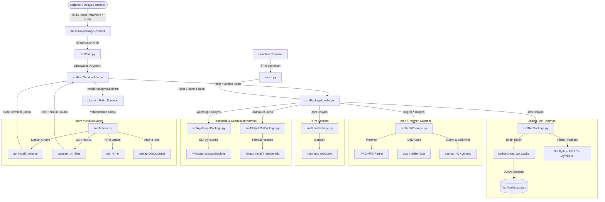

# Pars Linux Package Installer — Mimari ve Tasarım Spesifikasyonu

Bu doküman, `parslinux-package-installer` v3.0.0 uygulamasının teknik mimarisini, bileşenler arası veri akışını, durum makinelerini ve güvenlik modelini detaylandırmaktadır.

---

## 1. Genel Mimari Bakış

Uygulama, zayıf bağlı (loosely-coupled) bir model izleyerek kullanıcı arayüzü (saf **GTK 4 / Libadwaita**), evrensel çoklu format paket yükleyici (`PackageLoader`, `DebPackage`, `ArchPackage`, `RpmPackage`, `AppImagePackage`, `FlatpakRefPackage`), ayrıcalık yükseltme (Polkit `pkexec`) ve çoklu paket yöneticisi (`apt` / `pacman` / `rpm` / `flatpak`) katmanlarını birbirinden ayırır.

---

## 2. Temel Modüller ve Rolleri

### 2.1. `src/Main.py` (Libadwaita GApplication Giriş Noktası)
* **GApplication Kimliği**: `org.parslinux.package-installer`
* **Görevi**: 
  * Dosya yöneticisinden çift tıklamayla veya toplu seçimle gelen `do_open` sinyallerini karşılar.
  * Uçbirimden tekli veya çoklu argümanla başlatıldığında `do_activate` sinyalini yönetir (Tek dosya ise doğrudan paket görünümü, çoklu ise toplu kuyruk görünümü).
  * `-i` ve `-c` bayrakları verildiğinde grafik arayüz yüklemeden `src/cli.py` modülüne delege eder.

### 2.2. `src/MainWindowAdw.py` (Modern GTK4 / Libadwaita Arayüzü)
* Saf GTK 4 ve Libadwaita (`Adw.ApplicationWindow`, `Adw.ToolbarView`, `Adw.HeaderBar`, `Adw.ToastOverlay`) kullanır.
* **Arayüz Durumları (`Adw.ViewStack`)**:
  * `empty`: Paket yüklenmediğinde karşılama ve sürükle-bırak hedefi (`Adw.StatusPage`).
  * `package`: Paket bilgileri, sürüm rozetleri, içerilen dosyalar canlı arama sekmesi ve dinamik eylem butonları (Kur / Kaldır / Yükselt / Sürüm Düşür / Menüye Ekle / Başlat).
  * `batch`: Toplu paket kurulum kuyruğu (`Adw.ActionRow` listesi, onay kutuları ve toplam boyut özeti).
  * `broken`: Bozuk paket veya bağımlılık hatası uyarısı.
* **Canlı Dosya Ağacı**: Paket içerisindeki dosyaları tür ikonları (klasör, çalıştırılabilir, sembolik bağ, metin) ve boyutlarıyla anında filtreler.

### 2.3. `src/PackageLoader.py` (Evrensel Paket Fabrikası)
* Polimorfik paket fabrikasıdır:
  * `is_supported_package(path)`: Dosyanın `.deb`, `.pkg.tar.*`, `.rpm`, `.appimage`, `.flatpakref` veya `.flatpakrepo` olup olmadığını doğrular.
  * `open_package(path, cache=...)`: Dosya türüne göre uygun `DebPackage`, `ArchPackage`, `RpmPackage`, `AppImagePackage` veya `FlatpakRefPackage` nesnesi üretir.
  * `is_arch_system()`, `is_fedora_system()`: Çalışan dağıtımı otomatik tespit eder.

### 2.4. `src/ArchPackage.py` (Arch Linux Doğal Paket Motoru)
* `.pkg.tar.zst`, `.pkg.tar.xz`, `.pkg.tar.gz` arşivlerini çözer.
* `.PKGINFO` metaverilerini anahtar/değer çiftleri olarak ayrıştırır (`pkgname`, `pkgver`, `pkgdesc`, `depends`, `optdepends`, vb.).
* `zstd` açıcı akışıyla arşiv dosya ağacını ve izinlerini listeler.
* `pacman -Q` ve `vercmp` yardımıyla sistemde kurulu sürümü sorgular ve mimari uyumluluğunu kontrol eder.

### 2.5. `src/DebPackage.py` (Debian Paket Motoru)
* Hibrit çalışma mantığı: `python3-apt` varsa sistem kütüphanesini kullanır, yoksa dahili saf Python AR ve Tar arşiv ayrıştırıcısı ile çalışır.
* `get_file_details()` metoduyla her bir dosya üyesinin adı, boyutu, türü (dizin, dosya, sembolik bağ) ve izin modlarını raporlar.
* Mimari uyumsuzluğu ve eksik bağımlılıkları denetler.

### 2.6. `src/RpmPackage.py` (RPM Paket Motoru)
* `.rpm` paketlerini `rpm` ve `rpm2cpio` yardımcılarıyla sorgular ve dosya ağacını ayrıştırır.

### 2.7. `src/AppImagePackage.py` (Taşınabilir AppImage Motoru)
* ELF ikili başlığını doğrular, dahili simge ve `.desktop` metaverilerini okur.
* Kullanıcı oturumunda çalıştırma izni verme, `~/.local/share/applications/` altına entegre etme, başlatma ve menüden kaldırma eylemlerini yönetir.

### 2.8. `src/FlatpakRefPackage.py` (Flathub & Flatpak Referans Motoru)
* `.flatpakref` ve `.flatpakrepo` INI dosyalarını okur; Depo, Başlık, Uygulama Kimliği ve Dal (branch) bilgilerini sunar.
* `flatpak install` ve `flatpak remote-add` işlemlerini yönetir.

### 2.9. `src/Actions.py` (Ayrıcalıklı Kurulum ve Kaldırma Yardımcısı)
* Yalnızca `root` yetkisiyle PolicyKit (`pkexec`) üzerinden çağrılır.
* **Debian Ortamında**: `/var/lib/dpkg/lock-frontend` kilit kontrolü yapar; `apt install` veya `apt remove` yürütür.
* **Arch Linux Ortamında**: `/var/lib/pacman/db.lck` kilit kontrolü yapar; `pacman -U --noconfirm --needed` veya `pacman -Rns --noconfirm` yürütür.
* **Arch'ta .deb Kurulumu**: Arch Linux üzerinde `.deb` verilmişse `debtap` aracı ile paketi dönüştürüp kurar.

### 2.10. `src/cli.py` (Headless CLI Teftiş Modülü)
* Grafik arayüz yüklemeden terminalde hızlı paket analizi ve doğrulama sağlar.
* `cli_info()`: Paket metaverilerini (adı, sürümü, mimarisi, durumu, boyutu, açıklaması, bağımlılıkları) formatlı döküm olarak basar.
* `cli_check()`: Bağımlılıkları kontrol edip eksik paketleri listeler ve script otomasyonları için exit code (0: başarılı, 1: eksik) döner.
* Uzak URL'lerden HTTP/HTTPS paket indirme desteği sunar.

---

## 3. Test ve Kalite Güvencesi Mimarisi

* `tests/test_included_files.py`: `DebPackage` dosya ayrıştırma ve metaveri doğruluğu.
* `tests/test_batch_queue.py`: Toplu kurulum kuyruğu çoklu paket ayrıştırması.
* `tests/test_cli_modernization.py`: CLI `-i` ve `-c` bayrakları, CSS ve AppStream XML kontrolleri.
* `tests/test_arch_package.py`: Arch Linux paket metaverisi, `.PKGINFO`, zstd dosya ağacı ve pacman komut inşası.
* `tests/test_appimage_and_flatpakref.py`: AppImage ve Flatpakref / repo ayrıştırma ve entegrasyon testleri.
* `tests/test_rpm_package.py`: RPM metaveri ve komut inşası testleri.
* `tests/test_gui_integration.py`: GTK 4 / Libadwaita Debian, Arch, AppImage ve Flatpak pencere yaşam döngüsü testleri.
* `tests/run_all_tests.py`: Tüm testleri süreç izolasyonuyla koşturan ana çalıştırıcı (`./run.sh --test`).

